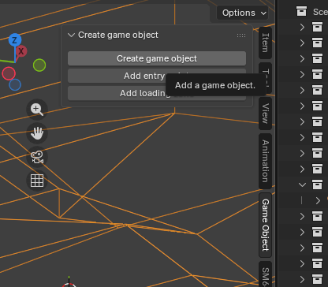
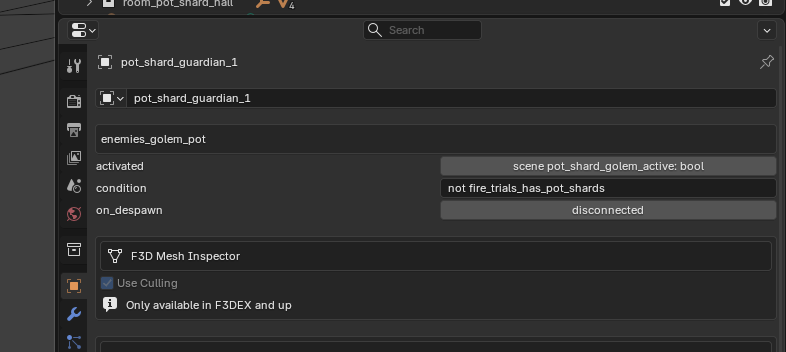
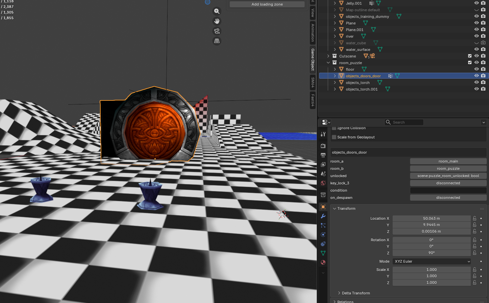
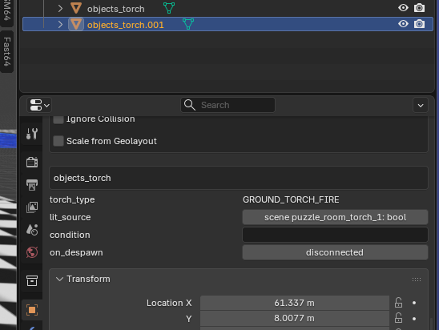
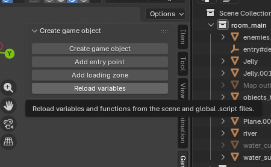

# Entites and Scripting

Entity types are defined in [scene_definition.h](../src/scene/scene_definition.h). To add an entity to blender, it also needs to be defined in [game_objects.json](../assets/game_objects.json). 

You can create an entity in the viewport under the GameObject section by clicking `Create game object`. The object you choose will be added a the the current cursor location.



Selecting it will show the properites you can edit in the objects tab.



Here are the parameter types and what they can do.

## primitives

* bool - adds a checkbox to enable or disable a setting
* uintx_t, intx_t - a number. X specifies the number of bits (8, 16, 32, 64). uint cannot be negative

## script variables

A script variable can be defined as a global in [globals.script](assets/scripts/globals.script) or as a scene variable in the scene `.script` file. A global will be saved in the savefile. A scene variable will only survive as long as the player is in the current scene. When they hit a loading zone and come back all the scene varaibles will be reset to the default.

Entities can communicate with each other or script code with the script variables. There are the different types

* boolean_variable - can reference a bool from a script
* integer_variable - can reference an i8, i16, or i32
* any_variable - can reference a boolean or integer variable

If an entity needs to reference another entity directly, use `entity_spawner`. All entities in a scene are created with their spawner. By default a spawner will simply spawn its entity and do nothing after that. But if an entity has a reference to another entity's spawner, it can lookup if it has been destroyed, lookup the entity id that was last spawned, and even respawn if needed.

## Room scripts

If you define a function in a scene script with the same name as a room in a blend file that script will be run on loop while that room is active.

## Puzzle example

There is a simple example in `ability_testing.blend`.

First lets look at the script

```
scene puzzle_room_unlocked: bool = true;
scene puzzle_room_torch_0: bool;
scene puzzle_room_torch_1: bool;

func room_puzzle()
    puzzle_room_unlocked = puzzle_room_torch_0 and puzzle_room_torch_1;
end
```

The first three lines define variables needed for the puzzle.

The func is run on a loop so once both torches have been lit the door will unlock using this logic `puzzle_room_torch_0 and puzzle_room_torch_1`.

Then looking at the blend file you can see the entities that are linked to these variables.



The door and two torches are organized into the `room_puzzle ` collection. In the objects tab you can see that the door has been linked to `room_main` and `room_puzzle` rooms. It has been given an unlocked boolean varaible `puzzle_room_unlocked` that when set will unlock the door. 



The torches each have their respective lit_source connected to one of the two variables defined in the scene.

## Reload variables

If you make changes to the script variables while a scene is open blender wont pickup on the changes by default. Instead you need to click `Reload variables` in the `Game object` panel.

