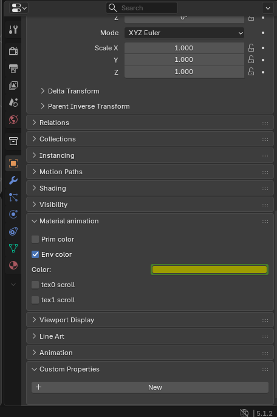

# Material animation

An armature can animate texture scrolling, prim color and env color. To use this feature create a an armature then attach any objects you want to animate to the armature. Each object can only animate a single set of values and they apply to all materials for that object. If you want to animate mulitple materials independendly you need to create an object for each set of values. You can animate up to 7 objects this way.

Once you have setup the armature and objects, look under the object panel for the object you want to animate and there will be an expandable section labelled "Material animation"

Check the box for any value you want to animate for this object. You can then choose what value you want for the property and add keyframes by putting the mouse cursor over the value and pressing the add keyframe hotkey (My binding uses 'i')