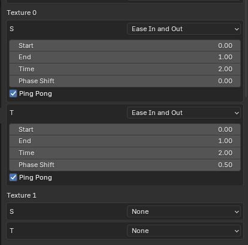

# Texture Scrolling

Here are the features for texture scrolling in the plugin

## Type

There are 5 types

* None - Disables texture scrolling
* Linear
* Ease In
* Ease Out
* Ease In and Out

Easing slows down the scrolling at the start or end

## Start/End

How much the texture if offset. 1 is a full texture width/height. If you use negative numbers it should be compensated by manually offsetting low S/T.

## Time

How long the scroll takes

## Phase Shift

A value between 0-1 that offsets a single cycle. Use to make S and T have start and end times that done exactly line up.

## Ping Pong

Makes every other cycle play in reverse. Combining ping pong with Ease In and Out makes an approximation of a sine wave.